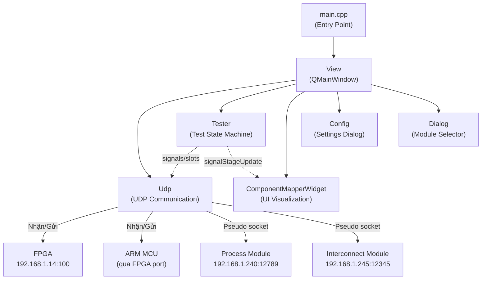
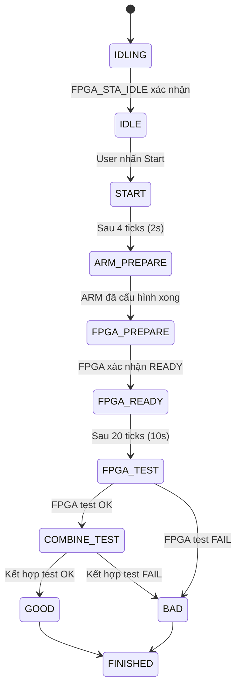
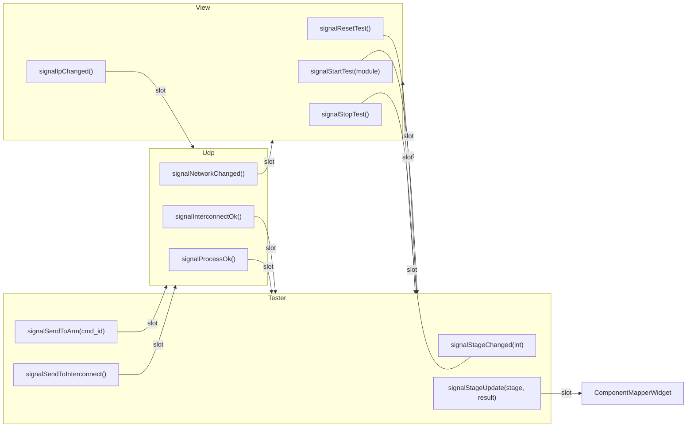

# Phân Tích Chi Tiết Dự Án Tester-2025

## Tổng Quan

**Tên ứng dụng**: Tester  
**Phiên bản**: 2.1.1 (build 2026-07-28)  
**Framework**: Qt (C++) — QWidgets + QNetwork  
**Nhà xuất bản**: Radar Department  
**Mục đích**: Hệ thống kiểm thử (testing) phần cứng thiết bị radar/RF qua giao thức UDP  

---

## Kiến Trúc Dự Án



---

## Các Module Chính

### 1. `main.cpp` — Điểm Khởi Động
- Phân tích **command-line arguments**: `--log / -l` (bật ghi log file), `--admin / -a` (chế độ admin)
- Khi bật log, ghi toàn bộ debug/warning/error ra file `log/Tester_yyyy-MM-dd_hh-mm-ss.log`
- Đọc cấu hình `Config.ini` → tải `g_cs_offset` (offset hiệu chỉnh tín hiệu phản xạ)
- Khởi tạo `View` (cửa sổ chính)

---

### 2. `udp_def.h` — Định Nghĩa Giao Thức

Đây là "xương sống" giao thức của toàn hệ thống:

#### Các Enum Quan Trọng
| Enum | Mục đích |
|------|----------|
| `ARM_CMD_ENUM` | Lệnh gửi xuống ARM MCU (mode, working, transmit, code, anten…) |
| `FPGA_CMD_ENUM` | Lệnh gửi xuống FPGA (IDLE, PREPARE, FPGA_TEST, COMBINE_TEST, RESULT) |
| `FPGA_STA_ENUM` | Trạng thái nhận từ FPGA |
| `RESULT_ENUM` | Kết quả: GOOD(0x00), BAD(0x01), TIMEOUT(253), UNKNOWN(254) |
| `MODULE_ENUM` | Loại module kiểm thử (TRANSMITTER, RECEIVER, TEST, INTERCONNECT, PROCESS, CODER, ANTEN1, ANTEN2) |
| `STAGE_ENUM` | **12 trạng thái** của máy trạng thái kiểm thử |

#### Địa Chỉ Mạng (Hard-coded)
| Thiết bị | IP | Port |
|----------|----|------|
| Host (PC) | 192.168.1.12 | 1000 |
| FPGA | 192.168.1.14 | 100 |
| Process Module | 192.168.1.240 | 12789 |
| Interconnect Module | 192.168.1.245 | 12345 |

#### Cấu Trúc Dữ Liệu Toàn Cục
- `ARM_DATA_STRUCT g_arm_cmd/g_arm_sta` — command và status của ARM
- `FPGA_DATA_STRUCT g_fpga_cmd/g_fpga_sta` — command và status của FPGA
- `int g_cs_offset` — offset hiệu chỉnh cường độ tín hiệu

---

### 3. `tester.cpp / tester.h` — Máy Trạng Thái Kiểm Thử

**Trái tim** của dự án — quản lý toàn bộ quy trình kiểm thử qua 12 giai đoạn (STAGE):

```
IDLING → IDLE → START → ARM_PREPARE → FPGA_PREPARE → FPGA_READY
       → FPGA_TEST → COMBINE_TEST → GOOD/BAD → FINISHED
```

#### Luồng Kiểm Thử Chi Tiết



#### Kiểm Thử Theo Từng Loại Module
| Module | Logic kiểm thử |
|--------|---------------|
| **TRANSMITTER** | Kiểm tra tín hiệu `csphanxa` (ADC): phải `> 0` và `≤ 150` |
| **RECEIVER** | Chạy **5 bước** (mode_id[0..4]), mỗi bước thay đổi mode ARM và chờ FPGA xác nhận |
| **INTERCONNECT** | Chờ UDP từ module Interconnect xác nhận kết nối (timeout 2s) |
| **PROCESS** | Chờ UDP từ Process module xác nhận (timeout tối đa 30s = 60×500ms) |
| **Others** (CODER, ANTEN…) | Trực tiếp dùng kết quả `g_fpga_sta.result` |

> **Timer**: chạy 500ms/lần → mỗi "tick" = 500ms

---

### 4. `udp.cpp / udp.h` — Lớp Truyền Thông UDP

#### 3 UDP Socket
| Socket | Mục đích |
|--------|----------|
| `m_udp` | Kênh chính — nhận từ FPGA+ARM, gửi lệnh tới FPGA và ARM |
| `m_pseduo_process` | Pseudo socket — lắng nghe Process Module |
| `m_pseduo_interconnect` | Pseudo socket — lắng nghe & gửi tới Interconnect Module |

#### Giao Thức Frame ARM (7 bytes / frame)
```
[0x55][CMD_ID][DATA1][DATA2][DATA3][DATA4][XOR_CHECK]
```
- XOR toàn bộ bytes phải = `0xFF`
- Hỗ trợ nhiều frame ghép trong một datagram

#### Giao Thức Frame FPGA (7 hoặc 26 bytes)
```
[0x55][0xFF][STATUS][DATA1][DATA2][DATA3][XOR_CHECK]
```
- XOR các byte 2..6 phải = 0

#### Lệnh Gửi Tới ARM (10 bytes)
```
[0x02][0x00][CMD][DATA1][DATA2][0x00][0x00][XOR][0x0D][0x0A]
```

#### Online Detection
- ARM/FPGA được coi là **offline** nếu không nhận được packet trong 5 × 500ms = **2.5 giây**

---

### 5. `ComponentMapper/` — Module Trực Quan Hóa

Module quan trọng nhất về giao diện — cho phép **ánh xạ linh kiện lên ảnh board mạch**:

#### Cấu Trúc Dữ Liệu
```cpp
struct ComponentInfo {
    QRect rect;      // Vùng linh kiện trên ảnh
    QString idName;  // Tên định danh (R1, C3, U5...)
    QString infoMsg; // Thông báo lỗi liên kết
};

struct ErrorInfo {
    QString testName;            // Tên bài test
    QList<int> componentIndices; // Các linh kiện liên quan
    QString errorMessage;        // Mô tả lỗi
};
```

#### `ComponentMapperWidget` — Chức Năng
- **Load ảnh board mạch** → vẽ vùng chọn (QRect) trên ảnh
- **Quản lý danh sách linh kiện** (`m_components`) và **danh sách lỗi** (`m_errors_1`, `m_errors_2`)
- **Lưu/Load project** (file định nghĩa component map)
- **Simulation**: Khi nhận `onStageUpdate()` → chạy animation mô phỏng hiển thị linh kiện bị lỗi
- **Admin mode**: Chỉ admin mới được chỉnh sửa, user thường chỉ xem kết quả
- **TestLogWidget**: Hiển thị log chi tiết từng bước kiểm thử

#### `ImageLabel` — Hiển Thị Ảnh Tương Tác
- Hỗ trợ vẽ/chọn vùng (QRect) trên ảnh bằng chuột
- Highlight các linh kiện (màu sắc theo kết quả PASS/FAIL)

---

### 6. `view.cpp / view.h` — Cửa Sổ Chính

- **QMainWindow** với menu: `Select`, `Start`, `Reset`, `Stop`, `Exit`
- Điều phối giữa `Udp` ↔ `Tester` thông qua Qt signals/slots
- Chạy `Tester` trong **QThread riêng** để không block UI
- Tích hợp `QProcess` để chạy tiến trình ngoài (có thể liên quan đến module PROCESS)
- Quản lý `ComponentMapperWidget` — load project theo module được chọn
- Điều hướng **Prev/Next** để xem các bước kiểm thử

---

## Sơ Đồ Signals & Slots



---

## Cấu Trúc File Dự Án

```
Tester-2025/
├── Tester.pro              # Qt project file
├── main.cpp                # Entry point, log, config
├── udp_def.h               # Giao thức, enums, structs, IP constants
├── udp.h / udp.cpp         # UDP communication layer
├── tester.h / tester.cpp   # Test state machine (logic cốt lõi)
├── view.h / view.cpp       # Main window (UI controller)
├── view.ui                 # Qt Designer UI
├── dialog.h / dialog.cpp   # Module selection dialog
├── dialog.ui
├── config.h / config.cpp   # Settings dialog
├── config.ui
├── ComponentMapper/        # Sub-module trực quan hóa
│   ├── ComponentInfo.h         # Data structures
│   ├── ComponentMapperWidget.h/cpp  # Widget chính
│   ├── ComponentDialog.h/cpp   # Dialog chỉnh sửa component
│   ├── ErrorSetupDialog.h/cpp  # Dialog cài đặt lỗi
│   ├── ImageLabel.h/cpp        # Ảnh tương tác
│   └── TestLogWidget.h/cpp     # Log widget
├── data/
│   ├── images/     # Ảnh board mạch
│   ├── results/    # Kết quả kiểm thử
│   └── steps/      # Dữ liệu các bước
├── resources/      # Icons
├── docs/           # Tài liệu dự án
├── Output/         # Installer packages (.exe)
├── setup.iss       # Inno Setup script (full install)
└── update.iss      # Inno Setup script (update only)
```

---

## Các Vấn Đề & Ghi Chú Kỹ Thuật

> **[CẢNH BÁO] IP Hard-coded**: Địa chỉ IP/Port của FPGA, ARM, Process, Interconnect được hard-code trong `udp_def.h`. Cần có cơ chế cấu hình động (Config.ini) để triển khai linh hoạt.

> **[GHI CHÚ] `QThread::sleep()` trong combineTest()**:  
> Hàm `combineTest()` gọi `QThread::sleep(3)` / `sleep(2)` / `sleep(1)` trực tiếp trong timer callback. Vì `Tester` chạy trong QThread riêng nên không block UI, nhưng đây là anti-pattern — nên thay bằng counter/timeout tương tự các giai đoạn khác.

> **[GHI CHÚ] Giao thức mới 2025**: Comment trong code ghi nhận một số thay đổi giao thức so với phiên bản trước:
> - `RESULT_GOOD = 0x00` và `RESULT_BAD = 0x01` (trước đây khác)
> - Xử lý `FPGA_STA_COMBINE_TEST`: `result ^= 0x10` — "Giao thức mới"

> **[GHI CHÚ] Admin mode**: Khi chạy với `-a` hoặc `--admin`, `ComponentMapperWidget` mở khóa chức năng chỉnh sửa component map và error list.

> **[MẸO] Bật log**: Chạy `Tester.exe --log` để ghi toàn bộ debug ra file, hữu ích khi debug hiện trường.

---

## Phiên Bản & Deployment

| Phiên bản | File | Ngày |
|-----------|------|------|
| 2.1.1 | `Tester-2.1.1-setup_2026-07-28.exe` | 2026-07-28 |
| 2.1.0 | `tester-2.1.0-setup.exe` | — |
| 2.1.0 | `tester-2.1.0-update.exe` | — (update only) |

- **Installer**: Inno Setup, nén LZMA solid compression (~33 MB)
- **Build**: Qt, output tại `build/bin/Tester.exe`

---

*Tài liệu được tạo tự động — 2026-07-30*
